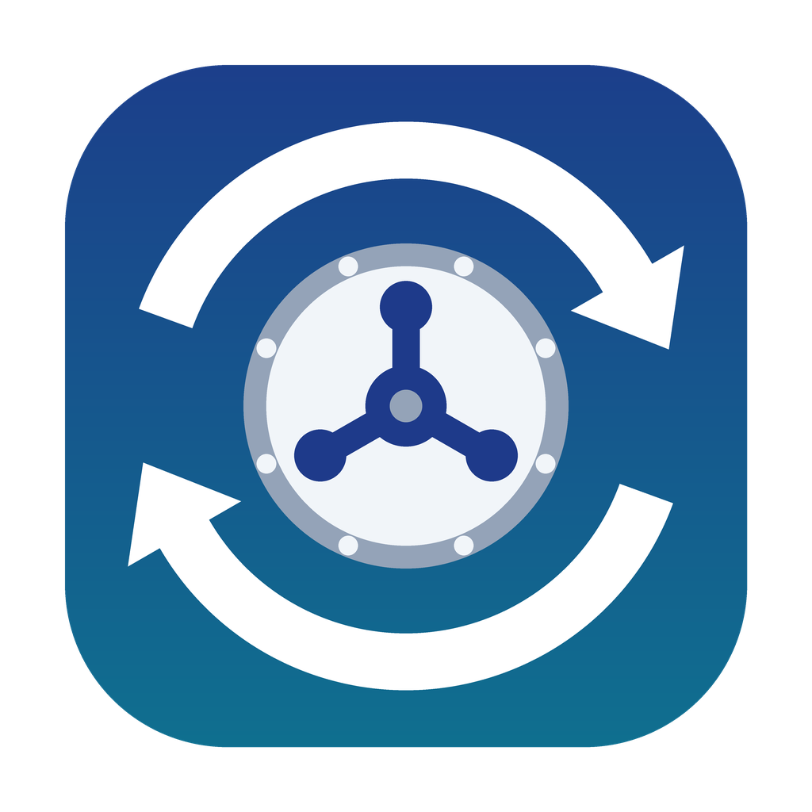

#  Vault Sync

Desktop app for Windows, macOS and Linux that keeps local copies of online collections up to date. Each kind
of source is its own sub-app with its own tab, and they can run at the same time: the GOG library, podcasts and
Tabletop Simulator mods.

## GOG Library tab

Keeps a local folder an exact mirror of a GOG library (offline installers and extras), built on
[gogrepoc](https://github.com/Kalanyr/gogrepoc).

1. **Log in** with a GOG account (Google/Discord sign-ins are not supported by gogrepoc). Two-step codes
   and sign-in links are asked for in a dialog when GOG requires them.
2. **Check for changes** scans the library and lists every file that would be downloaded and deleted,
   with sizes. Nothing is changed yet.
3. **Apply changes** moves the files to delete into `!orphaned`, downloads the new files, checks that
   nothing is left to download, and only then deletes `!orphaned`. If a download fails or the sync is
   cancelled, the old files are moved back. A sync interrupted by a crash is recovered at the next start.

Files are sorted into `Installer/` and `Extras/<category>/` subfolders per game. gogrepoc only finds files
directly in the game folder, so they are flattened before and sorted again after each run.

## Podcasts tab

Archives every episode of the podcasts on the watch list:
`<archive folder>/<podcast>/<NN>_<folder>/<YYYY-MM-DD> - <title>.mp3`, with the show notes in a `.txt`
file next to each episode.

- **Watch list:** add podcasts by RSS feed, or find the feed by name (**Find...**, searches the Apple Podcasts
  directory). Each podcast can be left out of checks without removing it. **Import...** reads a
  `podcasts.json` of the older `archive.py` script.
- **Folder rules** decide which folder an episode goes into: the first rule with a pattern (regular expression,
  case-insensitive) that matches the episode title wins. Episodes matching no rule get a folder named after the
  start of their title. Folder numbers follow the order of each folder's first episode and stay fixed. After a
  rule change, episodes already archived are moved, not downloaded again.
- **Check for new episodes** reads the feeds and lists what is new per folder; **Download new episodes** fetches
  it. Failed downloads are retried at the next run.

## Tabletop Simulator tab

Backs up Tabletop Simulator mods together with every image, 3D model, asset bundle, PDF and sound they use, so a
mod still works when its original links are gone.

- The **Mods** list shows every mod in the TTS `Mods/Workshop` folder, including the folders you made in TTS.
  Double-click a mod to leave it out of backups (or include it again).
- **Check** counts each mod's assets and how many are already in TTS's cache. Nothing is downloaded.
- **Back up** downloads every missing asset into TTS's own cache folders (with the file names TTS uses) and writes
  one zip per mod into the backup folder; mods in a TTS folder go into the same subfolder. Assets that can't be
  downloaded any more are listed in the log and in the zip's `manifest.json`.
- **Restore...** unpacks every backup zip of a folder into the TTS folders and adds the mods to TTS's mod list.
  Files that already exist are kept. This works on any computer, also without internet.
- Links that appear only inside a mod's scripts (e.g. alternative table textures) are backed up too.
- **Downloadable content:** the Arkham Horror LCG (SCE) mod downloads campaigns, scenarios and player cards from
  GitHub in-game. With this option on, those packs are saved as TTS Saved Objects
  (`Saves/Saved Objects/Arkham SCE Downloads/<mod version>/...`) and packed with their assets into a second zip,
  `<mod> - Downloadable content.zip`. After a restore, place them in TTS from **Objects → Saved Objects** (the
  mod's own download window always needs internet). Language packs: German by default, e.g. `German,French`,
  `all` or `none`. English + German is about 22,000 assets (roughly 30–45 GB), and the zip needs the same again.
  If the packs can't be fetched, the backup continues with packs from an earlier run and shows a warning.

The zips are compatible with the stand-alone `tts-backup` command line tool.

## User data

Settings, the GOG login (secret) and manifest, podcast state and logs are kept in the usual places per OS.
**Open data folder** in the app opens the data folder.

| | Settings | Data | Logs |
|---|---|---|---|
| Windows | `%APPDATA%\Vault Sync` | `%LOCALAPPDATA%\Vault Sync` | `%LOCALAPPDATA%\Vault Sync\Logs` |
| macOS | `~/Library/Application Support/Vault Sync` | same | `~/Library/Logs/Vault Sync` |
| Linux | `~/.config/vault-sync` | `~/.local/share/vault-sync` | `~/.local/state/vault-sync/logs` |

On Linux the `XDG_CONFIG_HOME`, `XDG_DATA_HOME` and `XDG_STATE_HOME` variables are respected. Setting
`VAULT_SYNC_HOME` keeps everything in that one folder instead (portable use).

On first start, the login, manifest and settings of the older GoG Sync (kept next to `GoG Sync.exe`) are
copied over. The old files are not changed.

## Download

Every change on `main` is built and published automatically as a new [release](../../releases) with builds for
each OS. Pull requests get test builds as artifacts of their [Build workflow](../../actions/workflows/build.yml)
run. The version is shown in the app's window header.

- **Windows:** `Vault Sync.exe`.
- **macOS (Apple Silicon):** `Vault Sync.app`. It is not signed, so the first start needs right-click → Open,
  or `xattr -dr com.apple.quarantine "Vault Sync.app"`.
- **Linux (x64):** `vault-sync`, a single executable (`chmod +x vault-sync`).

## Updates

When a release build starts, it checks GitHub for a newer release in the background. If there is one, it shows
what's new and asks whether to update: **Update now** downloads the build for this OS, puts it in place of the
current one, and restarts the app (running tasks are cancelled first, after asking). **Later** asks again at the
next start; **Skip this version** waits for the next one. If anything goes wrong, the current version keeps working.
Test builds (versions with `-dev`) and running from source never update themselves.

## Development

```sh
git submodule update --init                       # gogrepoc
python -m venv .venv
.venv/bin/python -m pip install -r requirements.txt pyinstaller   # Windows: .venv\Scripts\python.exe
.venv/bin/python app.py                           # run from source
.venv/bin/python -m unittest discover -t . -s tests
.venv/bin/python build.py                         # build for the current OS into dist/
```

On Linux, Tk must be installed (e.g. `sudo apt install python3-tk`).

- `app.py` – entry point and main window; also runs gogrepoc when started with `--gogrepoc`.
- `vaultsync/paths.py` – user data folders; `ui_common.py` – shared UI; `common.py` – shared helpers.
- `vaultsync/gog/` – GOG sub-app: `engine.py` (sync logic), `organize.py` (sorting), `tab.py` (UI).
- `vaultsync/podcasts/` – podcasts sub-app: `engine.py` (archive logic), `tab.py` (UI).
- `vaultsync/tts/` – Tabletop Simulator sub-app: `engine.py` (check/backup/restore), `tab.py` (UI); `mods.py`,
  `scanner.py`, `naming.py`, `downloader.py`, `package.py` (finding, downloading and packing assets) and
  `arkham.py` (Arkham SCE downloadable content).
- `.github/workflows/build.yml` – tests and builds for all three OSes; every push to `main` publishes a release.
- `VERSION`, `version.py` – versioning, see below.
- `vaultsync/assets/` – app icon in all formats, generated by `make_icon.py` (needs Pillow; the files are committed).

### Versions

`VERSION` holds the major.minor version (e.g. `1.0`). Every push to `main` is released as the next patch version
(`1.0.0`, `1.0.1`, ...), counted from the `v*` tags of earlier releases; the workflow creates the tag. For a new
minor or major version, change `VERSION` (e.g. to `1.1`); the next release is then `1.1.0`. Pull requests and
local builds get test versions such as `1.0.3-dev+abc1234`, and running from source shows `1.0-dev`.
`python version.py` prints the version a build of the current checkout would get. Pushes to `main` in quick
succession are built one after the other; if several are waiting, only the newest is released. If a push did not
start the workflow, run it by hand on `main` (Actions → Build → Run workflow) with **release** ticked.

## License

Vault Sync's own code is released under the [MIT License](LICENSE).

The builds also contain [gogrepoc](https://github.com/Kalanyr/gogrepoc) (included as a git submodule), which is
licensed under the GNU GPL v3 or later, and the other packages listed in `requirements.txt` under their own licenses.
Because gogrepoc is bundled, the ready-made builds as a whole are distributed under the terms of the GPL v3 or later.
